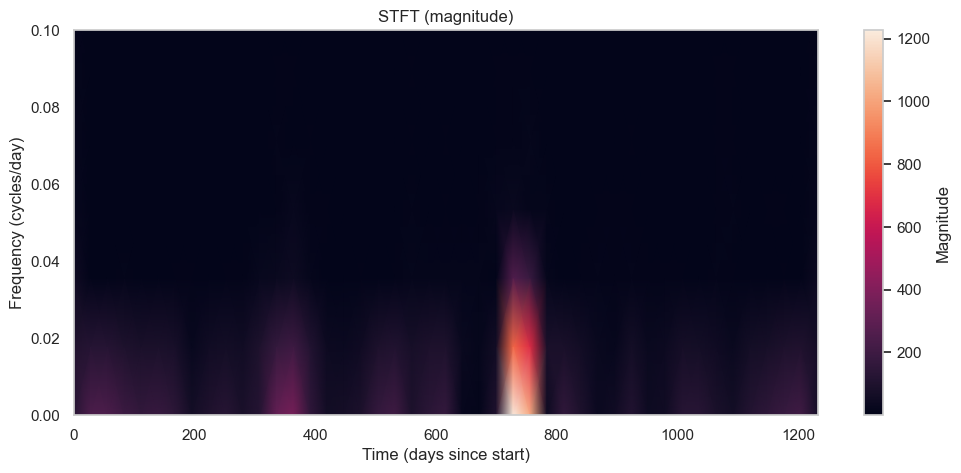
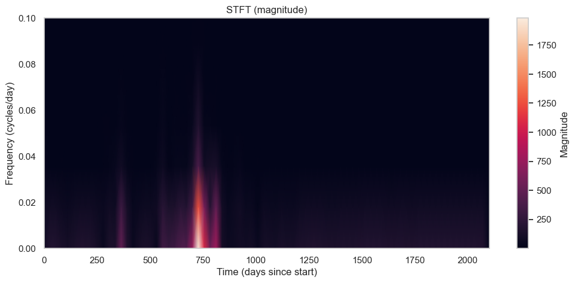
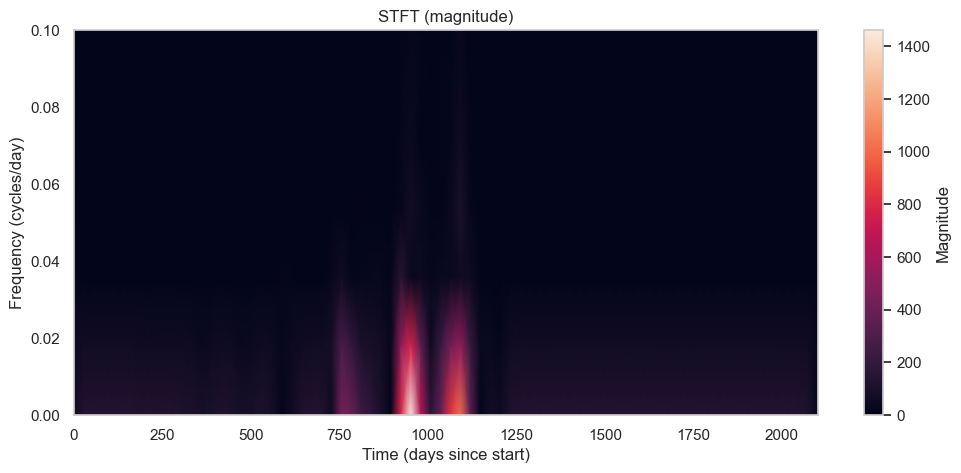
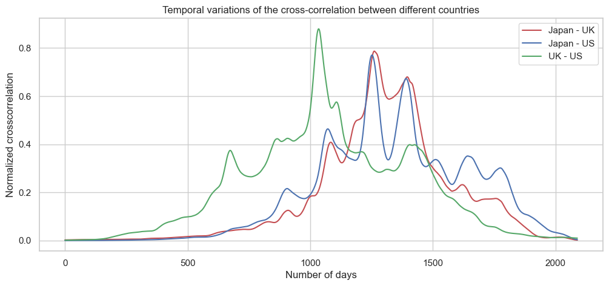
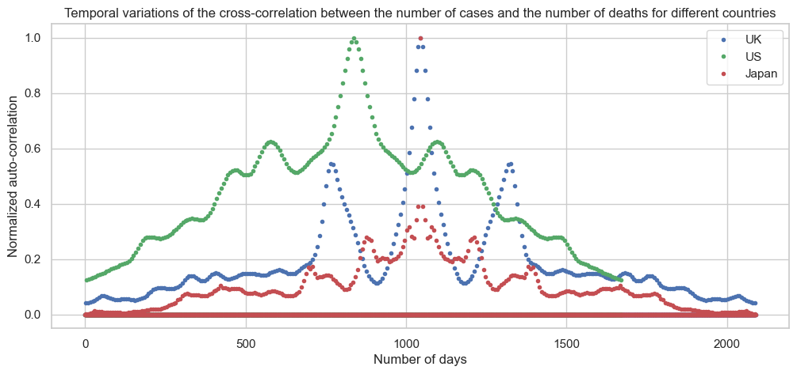

# COVID-19 Time–Frequency Analysis (STFT)

Signal-processing analysis of COVID-19 daily new cases and deaths per million people, with a focus on the **United States**, **United Kingdom** and **Japan**. The project treats each country's epidemic curve as a signal and applies:

- **FFT** – spectrum of the whole series, to find dominant periodicities (e.g. weekly reporting cycles, wave spacing)
- **Short-Time Fourier Transform (STFT)** – how that frequency content changes over time
- **Auto- and cross-correlation** – similarity between countries, and the time lag between cases and deaths

The full write-up is in [report/Group_11.pdf](report/Group_11.pdf).

## Repository layout

```
.
├── data/                # Input datasets (CSV)
├── notebooks/STFT.ipynb # Main analysis notebook
├── scripts/             # Small standalone FFT experiments
├── images/              # Figures generated by the analysis / used in the report
└── report/Group_11.pdf  # Final report
```

### Data

| File | Description |
|------|-------------|
| `data/daily-new-confirmed-covid-19-cases-per-million-people.csv` | Long format: `Entity`, `Day`, daily new confirmed cases per million (7-day rolling average) |
| `data/new_deaths_per_million.csv` | Wide format: `date` plus one column per country/region, daily new deaths per million |
| `data/d.csv` | Small extract (`date`, `us`, `world`, `uk`) covering 2020-03-01 to 2020-10-24, used by the scripts |

The case and death data come from [Our World in Data](https://ourworldindata.org/coronavirus).

### Scripts

| Script | Purpose |
|--------|---------|
| `scripts/f0.py` | FFT sanity check on a synthetic two-tone sine signal |
| `scripts/f.py` | FFT spectrum of US daily cases |
| `scripts/us-fft0.py` | Plots the US series and marks the start of the final 200-day window |
| `scripts/us-fft2.py` | Compares the US spectrum before and after day 180 |
| `scripts/control.py` | Eigenvalue check for a 2×2 matrix (unrelated side calculation) |

## Getting started

```bash
pip install pandas numpy scipy matplotlib seaborn jupyter
```

Run the notebook (it reads data from `../data/`, so start Jupyter from the repo root or `notebooks/`):

```bash
jupyter notebook notebooks/STFT.ipynb
```

Run any script from any directory:

```bash
python scripts/us-fft2.py
```

## Selected figures

| STFT – United States | STFT – United Kingdom | STFT – Japan |
|---|---|---|
|  |  |  |

| Cross-correlation (cases) | Cross-correlation (deaths) |
|---|---|
|  |  |
